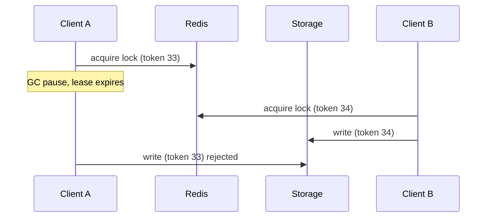

## 01 The problem: retries create duplicates

Clients retry on timeouts, load balancers retry on resets, and queues redeliver. Any non-idempotent `POST /payments` will eventually charge someone twice.

## 02 Idempotency keys

The client sends an `Idempotency-Key` header. The server stores the key with the request hash and the final response; a repeat returns the stored response.

```sql
create table idempotency_keys (
  key text primary key,
  request_hash text not null,
  response jsonb,
  locked_at timestamptz
);
```

> [!NOTE]
> Insert the key **inside the same transaction** as the side effect. If they commit separately you are back to the dual-write problem.

## 03 Why Redlock is not enough

Redlock acquires a lock on a majority of Redis nodes with a TTL. Martin Kleppmann showed that a GC pause or clock jump can let the TTL expire while the holder still believes it owns the lock, so two clients write at once.



## 04 Fencing tokens

Every lock grant carries a monotonically increasing token. The storage layer rejects writes whose token is lower than the last one it accepted. That makes correctness independent of timing.

> [!ANTIPATTERN]
> Using a distributed lock as the only guard for money movement. Locks are an efficiency tool; the database constraint is the correctness tool.

## Interview Q&A

**Q: Where do you store idempotency keys?** In the same database as the side effect, with a unique constraint.

**Q: How long do you keep them?** At least as long as the longest client retry window, commonly 24 hours.

**Q: What if two requests with the same key arrive at once?** The unique insert lets one proceed; the other waits or gets `409 Conflict`.
