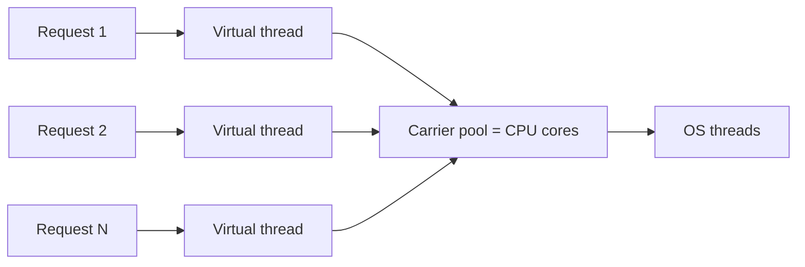

## 01 Why platform threads stop scaling

Before JDK 21 and Project Loom (JEP 444), every `java.lang.Thread` mapped 1:1 to an OS kernel thread. Each one reserves roughly **1 MB** of stack and costs a kernel context switch to schedule. Somewhere around a few thousand concurrent blocking requests, the machine runs out of memory or spends its time switching instead of working.

> [!TIP]
> Virtual threads do **not** make CPU-bound work faster. They maximize **I/O-bound throughput**. For heavy computation, keep platform workers and `ForkJoinPool.commonPool()`.

## 02 The M:N scheduler

A virtual thread is a continuation scheduled onto a small pool of *carrier* threads (a `ForkJoinPool` sized to the CPU count). When it blocks on I/O, the JDK unmounts it: its stack frames are copied to the heap and the carrier picks up another virtual thread.



```java
try (var executor = Executors.newVirtualThreadPerTaskExecutor()) {
    IntStream.range(0, 50_000).forEach(i -> executor.submit(() -> {
        Thread.sleep(Duration.ofMillis(100)); // unmounts, carrier is freed
        return i;
    }));
} // close() waits for all tasks
```

## 03 Pinning: when unmounting fails

A virtual thread is **pinned** to its carrier when it blocks inside a `synchronized` block (fixed in JDK 24 by JEP 491) or during a native/JNI call. A pinned thread holds the carrier for the whole blocking call, so a handful of pinned threads can starve the pool.

> [!CAUTION]
> Diagnose pinning with `-Djdk.tracePinnedThreads=full` on JDK 21–23, or the `jdk.VirtualThreadPinned` JFR event.

> [!ANTIPATTERN]
> Pooling virtual threads. They are cheap to create; a pool only adds a bottleneck. Limit concurrency with a `Semaphore` instead.

## Interview Q&A

**Q: Why can a JNI call pin a virtual thread?** The native frame lives on the carrier's OS stack, which the JVM cannot copy to the heap, so it cannot unmount.

**Q: Should you replace a `ThreadLocal` cache?** Yes, with care: a million virtual threads means a million copies. Prefer scoped values (JEP 446) or explicit caches.

**Q: What limits throughput once threads are cheap?** The downstream: connection pools, rate limits and database capacity. Bound them explicitly.
