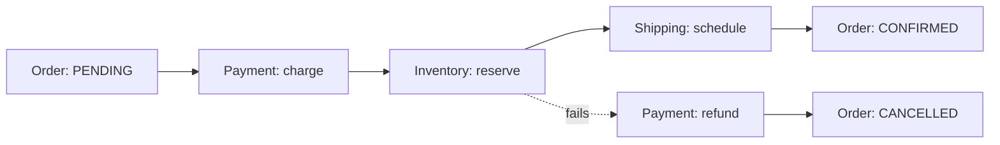

## Architectural executive summary

Two-Phase Commit guarantees ACID across stores at the cost of synchronous locking, cascading latency and a single coordinator. **Sagas replace one atomic transaction with a sequence of local transactions**, each with a compensating action, and accept eventual consistency to stay available.

## 01 The dual-write problem and the death of 2PC

Updating Postgres and publishing to Kafka "together" is not atomic. If the commit succeeds and the publish fails, downstream services never hear about it; publish first and a crash leaves an event for state that never existed.

> [!ANTIPATTERN]
> XA / 2PC across cloud microservices. Every participant holds row locks through the prepare phase; one slow node starves connection pools across the fleet.

The fix is the **transactional outbox**: write the event to an `outbox` table in the same local transaction, and let a relay (polling or CDC like Debezium) publish it.

## 02 Forward path vs compensation path



- **Orchestration**: a coordinator (Temporal, Conductor, or a state machine) calls each step and, on failure, runs compensations in reverse order. Easy to reason about and observe.
- **Choreography**: each service reacts to events and emits the next. No central brain, but the flow is spread across services.

## 03 Compensations must be idempotent

Messages are delivered at least once, so every step and compensation must tolerate repeats.

```java
@Transactional
public void refund(UUID paymentId, UUID sagaId) {
    if (refunds.existsBySagaId(sagaId)) return; // already compensated
    refunds.save(new Refund(paymentId, sagaId));
    outbox.save(new PaymentRefunded(paymentId, sagaId));
}
```

> [!NOTE]
> Sagas give up isolation: other transactions can see intermediate states. Use semantic locks (a `PENDING` status) and design reads to tolerate them.

## Interview Q&A

**Q: Orchestration or choreography for 6+ steps?** Orchestration: the flow stays in one place and timeouts are explicit.

**Q: What if a compensation fails?** Retry with backoff; it must be idempotent. After a limit, park it for manual repair.

**Q: How do you avoid lost events?** Transactional outbox plus at-least-once relay and idempotent consumers.
